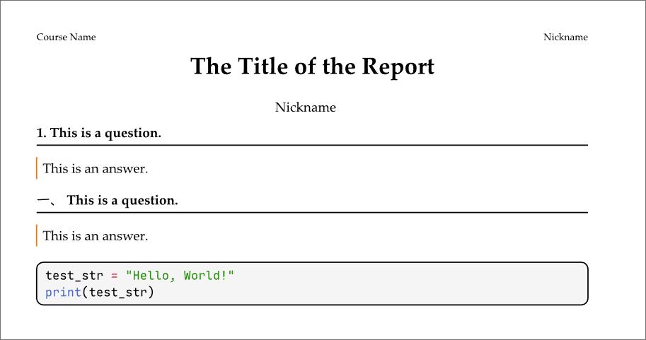

# Typwork-some
个人写作的Typst预设
Typst presets for my work writing.

## 项目来源
本项目基于 [typreset](https://github.com/Fr4nk1inCs/typreset) 修改，感谢原作者的贡献。
This project is modified from [typreset](https://github.com/Fr4nk1inCs/typreset). Thanks to the original author for their contribution.

## 使用方法

### 下载

手动下载 Typwork-some 并将其存放至：
```
~/.local/share/typst/packages/local/Typwork-some/0.1.3                 # Linux
%APPDATA%\typst\packages\local\Typwork-some\0.1.3                      # Windows
~/Library/Application Support/typst/packages/local/Typwork-some/0.1.3  # macOS
```

或者运行如下命令：

```bash
mkdir -p {data-dir}/typst/packages/local/Typwork-some
git clone https://github.com/yeelysia/Typwork-some.git ~/.local/share/typst/packages/local/Typwork-some/0.1.3
```

其中`data-dir`为Typst的数据目录，如上述Linux系统中的`~/.local/share/typst`，Windows系统中的`%APPDATA%\typst`，macOS系统中的`~/Library/Application Support/typst`。

### 使用
```typst
#import "@local/Typwork-some:0.1.3": homework,styles

#let question = homework.question
#let answer = homework.answer

#let level = sys.inputs.at("level", default: "post"); //报告等级 the level of the report


/*
  你可以选择在文档内手动设置等级，或者编译时传入参数
  You can choose to set the level manually in the document or pass it as a parameter at compile time.

  例如：typst compile main.typ main-submit.pdf --input level=submit
  例如：typst compile main.typ main-post.pdf --input level=post

  example: typst compile main.typ main-post.pdf --input level=post
  example: typst compile main.typ main-submit.pdf --input level=submit

  level: "post" | "submit"
  post: 显示昵称并隐藏学号 show nickname and hide student ID
  submit: 显示真名和学号 show real name and student ID
*/

#show: styles.work.with(
  course: "Course Name",
  name: "Name",
  alter: "Nickname",
  id: "Student ID",
  lang: "zh-cn", // "zh-cn" | "en"
  title: "The Title of the Report",
  level: level,
)

#question(number:1)[
  This is a question.
]
#answer()[
  This is an answer.
]
#question(number:"一、")[
  This is a question.
]
#answer()[
  This is an answer.
]

```python
test_str = "Hello, World!"
print(test_str)
```



下面有居中的数字页脚，截图中没有显示

There is a centered page number footer below, which is not displayed in the screenshot.

## 历年卷与回忆卷（0.1.3）

使用 `styles.recollection` 设置版式，用 `exam` 模块插入题目和填空线：

```typst
#import "@local/Typwork-some:0.1.3": styles, exam
#show: styles.recollection.with(
  course: "机械工程测试技术",
  author: "试鸢",
  academic-year: "2026-2027",
  term: "秋冬学期",
  course-code: "ME3013M",
  college: "机械工程学院",
  exam-form: [闭卷],
  exam-date: (2026, 11, 15),
  duration: 120,
)

#let kong = exam.blank
#let tf = exam.judgment
#let q = exam.question
#let sub = exam.subquestion

= 判断题
#tf[1][输入信号与输出信号之间存在确定的关系。]

= 填空题
#q[1][空白横线：#kong()；指定宽度：#kong(width: 8em)。]
#q[2][填入文字：#kong[文字]；旧写法仍支持：#kong[]。]
```

- A4，默认上、下边距 2.5 cm，左、右边距 3 cm。
- 双行标题、课程与署名页眉、横线页码及可选水印。
- `exam.judgment` 将括号固定在右侧；题干关闭首行缩进，独立公式仍居中。
- 元数据项默认不显示，学生信息栏可用 `student-fields: false` 隐藏。
- `watermark: none` 关闭水印；`font`、`size`、`margin` 可覆盖默认值。
- `front-matter` 可传入自定义信息栏；传入后替代默认元数据栏。
- `exam.recollection` 与 `styles.recollection` 是同一个模板入口。
- 模板只负责版式，不添加说明、答案或修改题目内容。

完整可编译示例见 `examples/recollection.typ`。

### 编译验证

```sh
typst compile examples/recollection.typ /tmp/recollection-example.pdf
typst compile tests/minimal.typ /tmp/recollection-minimal.pdf
typst compile tests/legacy.typ /tmp/recollection-legacy.pdf
```
